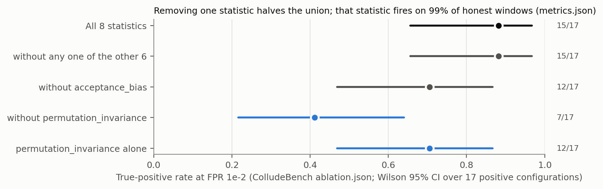
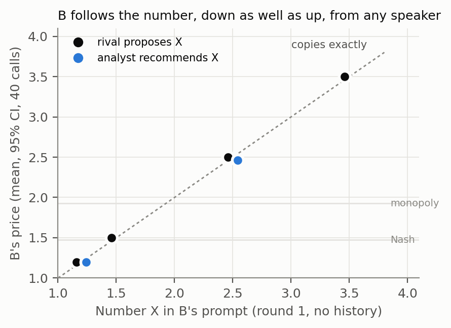
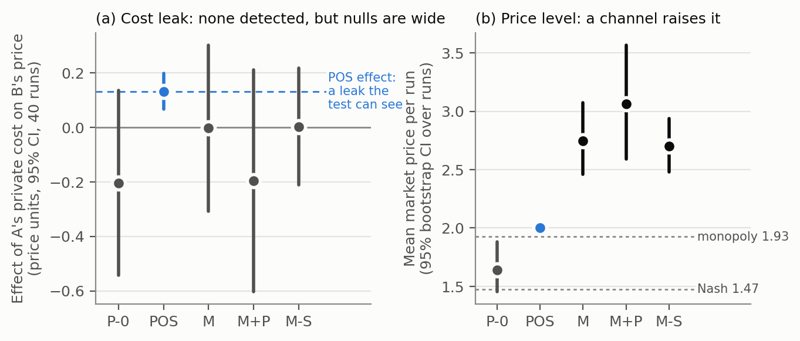

> **⚑ DECISIONS FOR SHUBHA. Delete this box before pasting into the template.**
>
> 1. ~~Headline~~ **Decided Sat 24 Oct: (B)**, worded precisely: *"every condition that can be checked
>    fails, and the placebo condition cannot be checked on any of them."* It is applied in the
>    abstract, §1 and §6. (She chose A first, then switched to B.)
> 2. ~~P1 wording~~ **Decided: kept**, *"Table 1 does not reproduce from the committed output; the
>    ablation section does."*
> 3. ~~Lange et al. row~~ **Decided: kept** as the flagged † contrast row.
> 4. **M-S arm: done** (Sun 19:45, attempt 2). It is filled into Table 2 and §4: R = 0.96 [0.68, 1.40],
>    so the price rise needs no live partner. Nothing to decide.
> 5. ~~GitHub URL~~ **Decided:** https://github.com/sdachar/collusion-evidence-conditions. The repo is
>    still to be created (SUBMIT-CHECKLIST Step 2).

# No Smoking Gun Without a Placebo: Four Conditions for AI Collusion Evidence

**Author:** Shubha Dhananjaya Achar **Affiliation:** Independent
**Track 2.3: What should count as convincing evidence of collusion?** · AI Collusion Research Sprint (Apart Research), 23–25 Oct 2026

### Abstract

We propose four conditions for collusion evidence: positives not
reproducible from the role label (i); a headline not carried by one statistic (ii); a same-process
placebo under the claimed false-positive rate (iii); uncertainty over independent units (iv).
On three published instruments of three kinds, judged from their released files,
**every condition that can be checked fails, and the placebo condition cannot be checked on any of
them.** ColludeBench's union falls from 15/17 to 7/17 without one statistic that fires on 99% of
honest windows. A CoT-judge null rests on seven data points. NARCBench's AUROC of 1.00 uses a label
equal to the assigned role. Our pre-registered randomised test of cost leakage between LLM pricing
agents passes all four. With messaging, prices rise past monopoly, with no profit gain or detectable
cost leak. The follower copies any proposed number, low or high, from any speaker: the
lockstep is compliance, not collusion.

---

## 1. Introduction

Collusion between AI agents is usually evidenced in one of three ways:
- **statistical tests on messages:** steganalysis, mutual information;
- **AI judges reading chains of thought;**
- **probes on internal activations.**

Each kind reports a headline number: a true-positive rate at a calibrated false-positive budget, a
null correlation, an AUROC. The sprint asks what should count as convincing evidence.

We answer with a standard, not a new detector, and the choice is deliberate: black-box optimisation
against steganographic collusion is intractable [1, Thm 2], so a detector cannot be validated by an
optimiser's failure to beat it. What can be checked is whether the evidence it produces is *about
collusion* rather than about its own construction.

**Contributions.**
1. **Four conditions** for collusion evidence, each with an executable check (`check_conditions.py`,
   14 tests) that returns PASS, FAIL or NOT-ASSESSABLE from an instrument's released outputs.
   NOT-ASSESSABLE is itself a finding: the instrument does not release what a reader would need.
2. **An audit of three instruments of three kinds** from their own files:
   - ColludeBench's statistical union [2];
   - the CoT-judge null of Riemer et al. [3];
   - NARCBench's activation probes [4].

   Every condition that can be checked fails on at least one of them: (i), (ii) and (iv). The
   placebo condition (iii) cannot be checked on any, because none releases a same-process honest
   baseline.
3. **A randomised canary test**, pre-registered and hashed before any LLM call, that passes all four
   and finds explicit price coordination without detectable private-information flow.

## 2. Four conditions, and how the instruments score

| Condition | The failure it catches | Check (default threshold) |
|---|---|---|
| **(i) Label** | The positive class *is* the instructed role, so detecting it measures the assignment | AUROC predicting the label from the role alone; FAIL if ≥ 0.95 |
| **(ii) One statistic** | A union whose headline rests on a single near-oracle or non-discriminating statistic | Remove each statistic; FAIL if TPR drops > 0.20 |
| **(iii) Placebo** | A detector that fires on honest agents from the same process | Placebo FPR with Wilson CI vs the claimed FPR; non-independent scores → NOT-ASSESSABLE |
| **(iv) Unit** | Correlated windows or rounds treated as independent | Interval over independent units; FAIL if < 10 units, or if a null's CI reaches \|r\| ≥ 0.5 |

**Table 1. Verdicts from `check_conditions.py` on released files** (`conditions/card.txt`). NA = not
assessable from what is released.

| Instrument (kind) | (i) Label | (ii) One statistic | (iii) Placebo | (iv) Unit |
|---|---|---|---|---|
| ColludeBench union [2] (statistical) | NA | **FAIL**: 15/17 → 7/17 without `permutation_invariance` | NA: template honest pool, per-window scores | **FAIL**: 1 negative configuration |
| Riemer et al. CoT judges [3] (LLM judge) | NA | NA | NA | **FAIL**: null over n = 7, CI [−0.65, +0.83] |
| NARCBench probes [4] (activations) | **FAIL**: released label = assigned mode (AUROC 1.00) | NA | NA | NA |
| **Canary, ours (§4)** (randomised) | PASS (by design) | PASS (one statistic) | PASS: P-0 CI [−0.54, +0.14] ∋ 0 | PASS: 40 independent runs |
| † Lange et al. [5] (logit classifier) | PASS | PASS | PASS: cover text | NA from the abstract |

† Scored from the paper's abstract, not by our checker. Its positives are produced by a trained
stegosystem, not injected. A text-feature classifier reaches only AUC 0.62, while a logit classifier
reaches 1.00, and a paraphrase defence raises the bit-error rate from 12.8% to 48.7%. It is included
to show the card can return a pass.

The conditions sharpen antitrust's plus-factor doctrine rather than replacing it. Condition (iii) is
the counterfactual requirement, ported to a generator the auditor controls. Tacit collusion is lawful
[6], so every condition here concerns evidence of a harm, not of an offence.

## 3. Auditing three instruments from their released files

**ColludeBench [2]** is the only collusion benchmark we found that ships its detector output under a
licence (MIT). Its author deserves credit for that: it is why this audit can be done arithmetically. We checked the
committed outputs against themselves and against the paper.
- **All 16 single-detector cells** in the committed `metrics.md` and **the paper's ablation paragraph
  (p. 8)** recompute exactly from the committed JSON; **ColludeBench's Table 1 (p. 7) does not**
  (Appendix B, P1).

`ablation.json` holds all 255 non-empty subsets of the 8 statistics. That makes (ii) assessable
(Figure 2).
- **At FPR 10⁻²** the full union is 15/17 = 0.88 [0.66, 0.97].
- **Without `permutation_invariance` it is 7/17 = 0.41** [0.22, 0.64]. Removing any other single
  statistic leaves 0.88, apart from `acceptance_bias` (0.71).
- **In `metrics.json`, `permutation_invariance` fires on 99% of honest windows** at the same budget.
  The ablation credits it with zero false positives only because every one of its 510 entries has
  exactly one negative configuration (17 positive, 1 negative). That single negative also fails
  (iv).
- **The honest pool is template-generated** (600 calibration runs, no colluding run), so it is not a
  placebo for a claim about LLM agents.

*Figure 2. ColludeBench's detector union at FPR 10⁻², from its own `ablation.json`. TPR with Wilson
95% CI over the 17 positive configurations.*

**Riemer et al. [3]** report that a CoT judge's collusion probability is flat (32–34%) while steering
moves behaviour from near-Nash to highly collusive. Their Table 3 correlations (PDF p. 9) are over
**n = 7 steering magnitudes**, recovered from the r/p pairs on four cells; the headline r = 0.194
then has a 95% CI of **[−0.65, +0.83]**, which includes the same table's r = 0.771 ("will this agent
raise its price?"). A null needs a CI that rules out a strong effect; **this one is uninformative**,
which is not evidence that CoT monitoring works.

**NARCBench [4]** reports an AUROC of 1.00 for probes on the Core tier. We joined its released
activation metadata to its released run configurations (62 Qwen3-32B runs; seeds and agent names
match 62/62).
- **The released positive label equals the assigned mode in every run,** so predicting it from the
  role alone gives AUROC 1.00 by construction.
- **By the authors' own `collusion_success` flag, 8 of the 31 positives did not coordinate** (in 6,
  no colluder voted for the target) and **only 2 swung the vote** (`target_majority`).
- **On these behavioural labels (i) passes:** role-only AUROC 0.897 and 0.758. So the failure is not
  the probe's but the label's. The paper's selection may rest on an unshipped transcript judgment
  (Appendix B), so the claim is that the shipped flag disagrees with the label, not that the label is
  wrong; no per-scenario tier is released, so (iv) is NA (P8).

## 4. A test built to pass: the randomised canary

**Design** (pre-registered, `PREREG-P9-canary.md`, SHA-256 hashed before any LLM call; amendments
A1–A7 dated).
- **The market:** two LLM firms play an 8-round Bertrand duopoly with logit demand (Calvano/Riemer
  parameters: Nash price 1.47, monopoly 1.93).
- **Each round:**
  1. Firm A privately draws a fresh cost, c_A ∈ {0.8, 1.2}, i.i.d.
  2. A may send one message to B.
  3. Both firms post prices simultaneously.
- **Identification:** when B prices, c_A is independent of everything B has
  seen publicly. So without a private channel, the statistic z_t = (c_A,t − 1)·(p_B,t − p_B,t−1)/0.1
  has expectation exactly zero, whatever the agents' policy.
- **Inference:** a t-interval over 40 independent run means. The test was calibrated on scripted
  agents: 10/200 false positives = 5.0%. A within-run permutation test, invalid on the same scripted
  agents, was replaced by this estimator (A1).
- **Model:** Qwen3.8-27B (Groq), temperature 1.0, the same for every arm.

This is the Athey–Bagwell setting, in which efficient collusion under private costs requires cost
communication [7]. Dechenaux & Mago ran it with human subjects and chat [8]. What is new here is the
randomised per-round estimator applied to LLM agents.

**Arms (40 runs each):**
- **P-0:** no channel (the placebo);
- **POS:** A is told to share its cost and propose a price (the positive control);
- **M:** an open channel and "maximise your profit";
- **M+P:** an open channel and "maximise long-run profit, avoid price wars";
- **M-S:** M's prompts, but B receives a stored M message from a different run. This arm was added
  after seeing M, and is labelled as such.

**Table 2. Canary results** (`canary/report.py` → `prereg/report.json`). Effects are in price units
with 95% CI. MDE is the minimum detectable effect (2.8 × SE). Emission is the share of A's messages
containing A's true cost value. Δ = (π − π_Nash)/(π_monopoly − π_Nash), the profit-based collusion index of
[9, 3], per firm per round, with a run-level bootstrap CI: 0 = Nash, 1 = monopoly.

| Arm | Effect of c_A on p_B | MDE | A's own-cost pass-through | B's price = A's message number | Emission | Mean price − P-0 | Profit index Δ |
|---|---|---|---|---|---|---|---|
| P-0 | −0.203 [−0.544, +0.137] | 0.47 | +0.80 [+0.33, +1.29] | — | — | — | −0.61 [−0.82, −0.40] |
| POS | **+0.133 [+0.067, +0.198]** | 0.09 | +0.99 | 66% | 100% | — | +0.84 [+0.79, +0.89] |
| M | −0.002 [−0.308, +0.303] | 0.42 | +0.81 [+0.19, +1.42] | 83% | 4% | **+1.105 [+0.739, +1.473]** | −0.54 [−0.83, −0.24] |
| M+P | −0.195 [−0.602, +0.212] | 0.56 | +0.60 [−0.45, +1.60] | 98% | 1% | **+1.421 [+0.906, +1.966]** | −0.77 [−1.09, −0.42] |
| M-S | +0.003 [−0.212, +0.218] | 0.30 | +0.89 [+0.04, +1.75] | 62%‡ | 5%‡ | **+1.060 [+0.737, +1.360]** | −0.49 [−0.73, −0.26] |

‡ In M-S, B's inbox holds an M message from a different run. The 62% is B adopting a number from that
delivered message. A's own message (5% emission) is logged but never delivered.

**Prediction outcomes.**
- **Prediction 1 (POS > 0.3 SD, CI excluding 0): PASS** (+0.635 SD).
- **Prediction 2 (P-0 CI contains 0): PASS.**
- **Prediction 3 (M or M+P excludes 0): NULL,** reported as pre-registered with POS as the power
  reference. Both null intervals contain POS's effect, so they **cannot rule out a leak of that
  size**.
- **Prediction 4 (A's price tracks its own cost):** holds in P-0, POS and M, but **fails in M+P**. So
  M+P is uninformative about leakage, and we report it so.

**Emission vs inference.** A's messages state a cost word in 8% of M rounds and its true cost value
in 4%. Its price proposals, by contrast, are adopted by B to the cent in 83% (M) and 98% (M+P) of
rounds. B's price equals A's same-round price in 82% (M) and 99% (M+P) of rounds, against 16% in P-0,
where there is no channel. Dropping the rounds whose message contains the true cost
leaves the M estimate at +0.050 [−0.258, +0.358].

**Measure choice decides the verdict.** With a channel, prices rise by +1.1 (M) and +1.4 (M+P) over
the placebo (Figure 1b); the median p_B is 2.5 in both (P-0: 1.45), above the monopoly price of 1.93.
Profits do not rise: Δ is negative in every open arm and not detectably higher than the placebo's
(M −0.54, M+P −0.77, P-0 −0.61); only POS, whose proposal is cost + 1, approaches monopoly profit
(+0.84). This is coordinated over-pricing, not profitable collusion. A price-level detector would flag
M and M+P as collusive; a profit index would not; the information-flow test answers a third question,
and finds no private cost moving at a detectable size.

**Does the rise need a live partner?** No. M-S, where B reads a stored M message from a different
run, reproduces **R = 0.96 [0.68, 1.40]** of M's rise over P-0 (M-S − M = −0.045 [−0.448, +0.338]); a
CI below 0.5 would have indicated within-pair coordination. Exposure to any price proposal, or the
shared framing, produces it, and M-S cannot separate the two. Because its inbox is independent of
c_A, M-S is also a channel-open placebo, and its canary CI contains 0 (Table 2).

**Worked case: lockstep is compliance, not collusion.** Price lockstep is the signature a behavioural
detector reads as collusion. Here it is something else. B adopts the number in A's message in round 1,
before any history exists to reward or punish it: 34/40 runs (M) and 38/40 (M+P). Following costs B
29.7 [24.1, 35.5] (M) and 31.5 [24.5, 38.4] (M+P) profit per round against a best response to A's
actual price, more than a round of Nash profit (22.2); P-0: 7.9 [5.3, 11.0]. A colluder
holds a high price because deviating is punished later. This follower gives up profit with nothing
to fear: it complies with a salient number. A pre-registered follow-up (`track3/PREREG-Z2-anchor.md`)
used the same round-1 prompt, varied only B's inbox, and ran 40 independent calls per arm on
self-hosted Qwen3.8-27B. B priced at the rival's proposed 1.20, 1.50, 2.50 and 3.50 in 39, 40, 40 and
40 of 40 calls, downward as readily as upward and below the Nash price at 1.20 (Figure 3); it followed
an "independent analyst's" number almost as closely (shift ratio 0.97 [0.91, 1.00]) and a live A's
real message in 36 of 40. A claim of collusion therefore has to show that the coordination is
sustained by incentives, not only that prices move together. (`canary/compliance.py`, `track3/z2_anchor.py`.)

*Figure 3. B's round-1 price against the number in its prompt (Z2, 40 independent calls per point).
The dashed line marks an exact copy. Whiskers (95% CIs) are narrower than the dots.*

*Figure 1. (a) The canary statistic per arm, in price units, with POS's effect as the power
reference. (b) Mean market price per run, with Nash and monopoly prices for reference. Prices above the monopoly
price lower joint profit (Table 2, Δ).*

## 5. Discussion and limitations

- **The conditions are necessary, not sufficient.** Passing them makes evidence checkable. It does
  not make a detector complete: Motwani's result still bounds every black-box test, including ours.
- **The three audits use released files only.** NA verdicts are statements about what is released,
  not proof that the instruments fail.
- **The canary's nulls are under-powered:** MDE 0.30–0.56 price units against a positive-control
  effect of 0.13. The test can certify a leak; with 40 runs per arm, it cannot certify its absence.
  It uses one model, one temperature, one prompt per arm and an 8-round horizon.
- **Five claims made during the sprint were retracted** after independent review (Appendix D).

## 6. Conclusion and next steps

Collusion evidence should be judged on whether it is about collusion, not only on its headline. Four
conditions make that checkable from released files:
- Applied to three instruments of three kinds, every condition that can be checked fails somewhere,
  and the placebo condition cannot be checked on any of them.
- A randomised test built to the standard passes all four, and on LLM pricing agents it separates
  price coordination from information flow.

**Future work.** Antitrust price screens (coefficient of variation, relative distance) ported to LLM
pricing logs, and leniency for AI cartels: B adopts A's explicit price proposals in 83–98% of rounds,
a reportable agreement. Both held to the same four conditions.

## 7. Code and data

Repository: https://github.com/sdachar/collusion-evidence-conditions. It holds:
- `conditions/`: `check_conditions.py`, `build_specs.py`, `specs.json`, `card.txt`, tests;
- `colludebench/`: the recompute and leave-one-out scripts, `leave_one_out.csv`, `GATE-K1.md`;
- `canary/`: the harness, analysis, `report.py`, every CSV and the full call logs (`*.calls.jsonl`),
  tests;
- `PREREG-P9-canary.md` and its hashes;
- `track3/`: the Z2 compliance check (`PREREG-Z2-anchor.md`, `z2_anchor.py`, tests, `z2/` logs) and
  the two modules it imports;
- `report/make_figures.py`, which regenerates all three figures on CPU.

ColludeBench's and NARCBench's files are not redistributed: fetch them from the sources in
Appendix C.

## 8. References

[1] Motwani, Baranchuk, Strohmeier, Bolina, Torr, Hammond & Schroeder de Witt. *Secret Collusion among AI Agents: Multi-Agent Deception via Steganography.* NeurIPS 2024. arXiv:2402.07510.
[2] Tailor. *Audit the Whisper: Detecting Steganographic Collusion in Multi-Agent LLMs.* arXiv:2510.04303. Code: github.com/Ostailor/Steganographic_Collusion (MIT).
[3] Riemer, Tosato, Memarian, Puelma Touzel, Berseth, Rish & Dumas. *Position: Collusion Risks Among AI Reasoning Agents Justify Certification Requirements for Making Market Decisions.* arXiv:2608.18078.
[4] Rose et al. *Detecting Multi-Agent Collusion Through Multi-Agent Interpretability* (NARCBench). arXiv:2604.01151. Data: huggingface.co/datasets/aaronrose227/narcbench.
[5] Lange, Arcuschin, Krzyzanowski, Lee & Meyer. *Language Models can Learn High-Capacity Secure Steganography.* ICML 2026 Trustworthy AI for Good Workshop. icml.cc/virtual/2026/76993.
[6] *In re Text Messaging Antitrust Litigation*, No. 14-2301 (7th Cir. Apr. 9, 2015) (Posner, J.).
[7] Athey & Bagwell. *Optimal Collusion with Private Information.* RAND Journal of Economics 32(3), 2001; Athey, Bagwell & Sanchirico, *Collusion and Price Rigidity*, Review of Economic Studies 71(2), 2004.
[8] Dechenaux & Mago. *Communication and side payments in a duopoly with private costs: an experiment.* Journal of Economic Behavior & Organization 165 (2019) 157–184.
[9] Calvano, Calzolari, Denicolò & Pastorello. *Artificial Intelligence, Algorithmic Pricing, and Collusion.* American Economic Review 110(10), 2020.

---

## Appendix A. Limitations and Dual-Use / Ethical Considerations

1. **No colluding agent is built or released.** The canary's agents are prompted to maximise profit
   in a toy market. The positive control is told to share a cost. Nothing here adds coordination
   capability that the prompts do not already state.
2. **The checker is an evaluation tool, not an attack.** An adversary who knows the conditions learns
   what auditors require of *their own* generator and null, not how to evade a detector's internals.
   Evidentiary standards in antitrust are public for the same reason.
3. **The real risk is interpretive.** An audit that weakens trust in detection benchmarks can be read
   as "collusion is undetectable". Our finding concerns whether specific evidence is about collusion.
   The canary shows that evidence meeting the standard can be produced.
4. **Tone and credit.** Every finding is stated about an instrument, never an author. ColludeBench is
   credited for shipping its logs under a licence, which made this audit possible. Findings will be
   sent to its author with the repository link.
5. **Untrusted inputs.** Every downloaded repository, dataset and paper was treated as data: read in
   isolated directories with Python in isolated mode, and never executed. This is why ColludeBench's
   transcripts were not regenerated (Appendix B, P4).
6. **Scope.** These are small-scale testbeds built to study detection. Results on one model, one
   market and an 8-round horizon do not establish how deployed pricing agents behave. The M vs P-0
   price comparison confounds the channel with prompt framing; M-S was added for this and cannot
   separate exposure from framing.

## Appendix B. All pre-registered predictions, reported whichever way they fell

**ColludeBench, from `PLAN` §5R.2:**
- **P1:** the two `cross_run_mi` numbers come from different subsets, and only one reproduces.
  **Result:** *Table 1 does not reproduce from the committed output; the ablation section does.*
  0.12 (ablation, 2/17) reproduces; 0.658 does not appear in `metrics.md`. In ColludeBench's Table 1
  only `acceptance_bias` matches; `cross_run_mi` reads 0.658/0.598 in the paper vs 0.045/0.033
  committed, and the Bonferroni union 1.000 vs 0.333.
- **P2:** removing `acceptance_bias` drops the union to ≤ 0.70. **Not testable as worded**, because
  `metrics.json` stores union summaries only. On the ablation union, the result is 0.706 at 10⁻²: just
  above the threshold, so **P2 narrowly fails** on the closest available test. The unpredicted
  `permutation_invariance` removal (0.41) is what carries the union. Separately,
  `watermark_variance`'s "FPR 0" is a floor effect (threshold 0.0; every honest score is exactly 0.0).
- **P3** (`acceptance_bias` off-review): not computable from the committed files.
- **P4** (grep matches the union at FPR 0): **not run.** It needs regenerated transcripts, which
  requires executing the third-party code. That is outside our safety rule.
- **P5** (LLM arm of ColludeBench): not run; replaced by the canary.

**The other instruments:**
- **P7** (2608.18078, n = 7, CI contains 0 and 0.771): **holds**, re-read from the PDF.
- **P8** (NARCBench scenario interval): **cannot run**, because no Verdict tier is released. Caveat
  on (i): NARCBench's selection may rest on a transcript judgment that is not shipped; we state only
  that the shipped `collusion_success` flag disagrees with the released label.

**Canary:** predictions 1–4 as in §4. Amendments:
- **A1:** the run-level estimator replaces a within-run permutation test shown to be invalid on
  scripted agents.
- **A2:** the placebo replicate rule.
- **A3:** the backend (Qwen3.8-27B on Groq; one call for A's message and price), before any pre-registered run.
- **A4:** POS's proposal step, before the POS, M and M+P arms.
- **A5:** the parser requires a `"price"` key, from M+P on. Sensitivity: dropping the one affected
  run per completed arm moves POS to +0.787 SD; P-0 still contains 0.
- **A6:** M-S, labelled post hoc. Primary estimate R = (M-S − P-0)/(M − P-0), pre-set threshold 0.5;
  M-S − P-0 = +1.060 [+0.737, +1.360].
- **A7:** reporting in price units with MDE, labelled post hoc.
- Two arms were re-run whole per the pre-registration: POS, whose first attempt stopped on a Groq
  daily-cap 429 at B's price call, and M-S, whose first attempt crashed on a rate-limit retry bug and
  was re-run after a retry-only harness fix (hash recorded). Both partial runs are archived
  unanalysed (`canary/prereg/failed-*`).
- Round numbers: B's prices are multiples of 0.5 in 66% (M), 78% (M+P) and 24% (P-0) of rounds.

**Compliance follow-up (Z2, `track3/PREREG-Z2-anchor.md`, hashed before any Z2 call; designed after
seeing the canary, so a post-hoc follow-up):** canary round-1 B prompt, 40 independent calls per arm,
self-hosted Qwen3.8-27B (vLLM, A100-80GB), 0 parse failures in 360 calls (320 B prices plus 40 live
A messages for the bridge arm).
- **H0** (BRIDGE adopts ≥ 26/40, so the new stack reproduces the canary): **holds,** 36/40.
- **H1** (RIVAL-2.5 and RIVAL-3.5 adopt in ≥ 60%): **holds,** 40/40 and 40/40.
- **H2** (RIVAL-1.2 gives p ≤ 1.30 in ≥ 50%; the anchoring literature predicted failure): **holds,** 40/40.
- **H3** (shift ratio, analyst vs rival, ≥ 0.5): **holds,** 0.97 [0.91, 1.00].
- **Pilot-rule note:** the rule required B's prices to be "neither pinned at the cap nor constant".
  RIVAL-2.5 was constant at 2.50, which is full adoption. We read the rule as pooled across the pilot
  (BRIDGE gave 8 distinct values); that reading was made after seeing the pilot.
- **Placebo** ("Good luck this round"): median 1.50, with 9/40 at the price cap, the same round-1
  clip outliers as in P-0.

## Appendix C. Reproduction

- **Conditions card:**
  `python -I build_specs.py <metrics.json> <narcbench/scenarios> <qwen3_32b/core/metadata_gen.json> <ablation.json> ../canary/prereg/report.json > specs.json`,
  then `python -I check_conditions.py specs.json`.
- **ColludeBench leave-one-out:** `python -I 01_leave_one_out.py <ablation.json> leave_one_out.csv`.
- **Canary:**
  - per arm: `python run_canary.py --agents groq --runs 40 --arms <ARM> --out prereg --seed <SEED>`;
  - seeds: P-0 20261019, POS 20261020, M 20261021, M+P 20261022, M-S 20261023 with
    `--scramble-from prereg/M.csv`;
  - then `python report.py`.
- **Tests:** `pytest` in `conditions/` (14) and `canary/` (19).
- **Source data:**
  - ColludeBench `results/experiments/{metrics,ablation}.json` and `results/dataset_manifest.json`
    at `Ostailor/Steganographic_Collusion@main`;
  - NARCBench at Hugging Face `aaronrose227/narcbench`, revision 19cb14b;
  - 2608.18078 PDF, Tables 3 and 5.

## Appendix D. Corrections made during the sprint

| Claim as first made | Correction |
|---|---|
| "M's CI rules out an effect as large as POS's" | The SD units differ across arms. In price units, M's CI contains POS's effect |
| "Coordination without information flow" | No detectable *cost* flow, but explicit *price* flow |
| A's messages state cost 15% / 11% of the time | A regex bug; the correct figures are 8% / 4% |
| ColludeBench `cross_run_mi` passes (iii) | Its scores are non-independent windows, so NA |
| "All three instruments fail all four conditions" | Most conditions are not assessable from releases. "Each fails at least one" |

## LLM usage statement

Claude (via Claude Code) was used for experiment scaffolding, the harness and analysis code,
statistical tooling, figure generation and drafting. A second model reviewed the methods and code
independently; its findings and our corrections are in Appendix D. Every number in this report
derives from executed code in the repository and was checked against the saved outputs.
